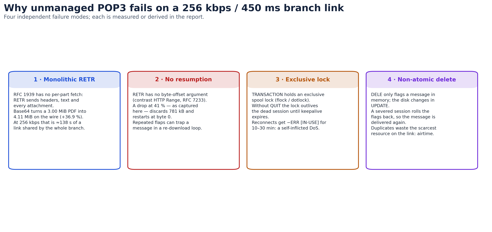
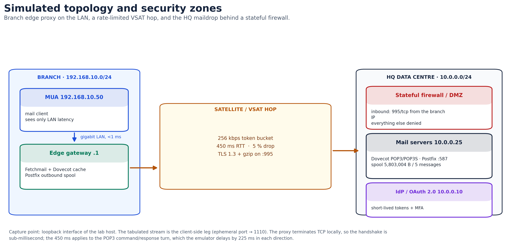
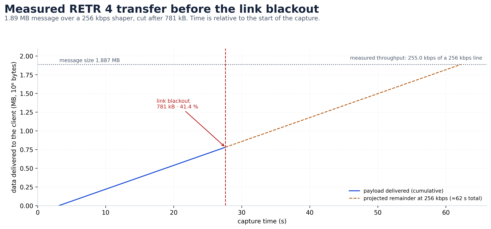
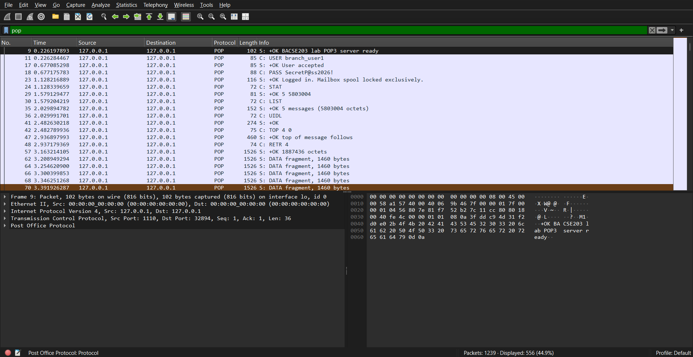
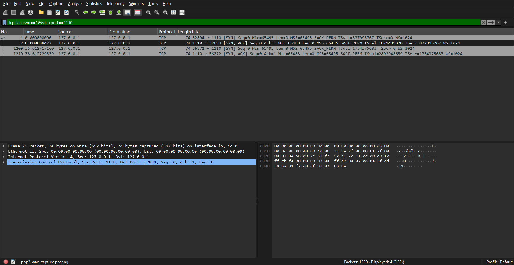
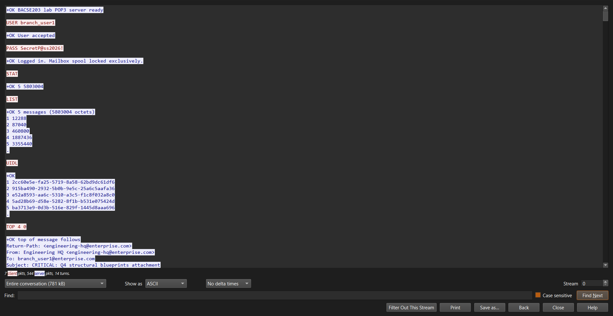
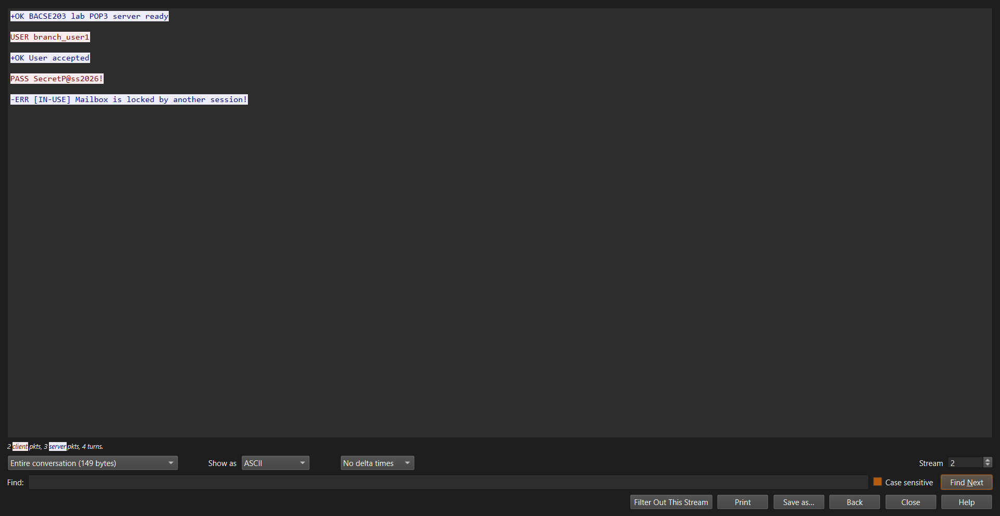
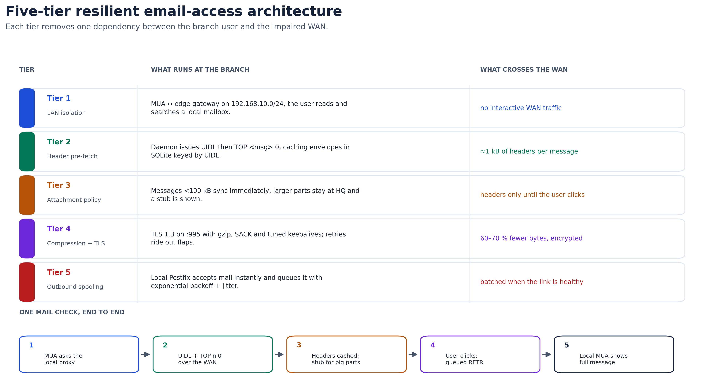
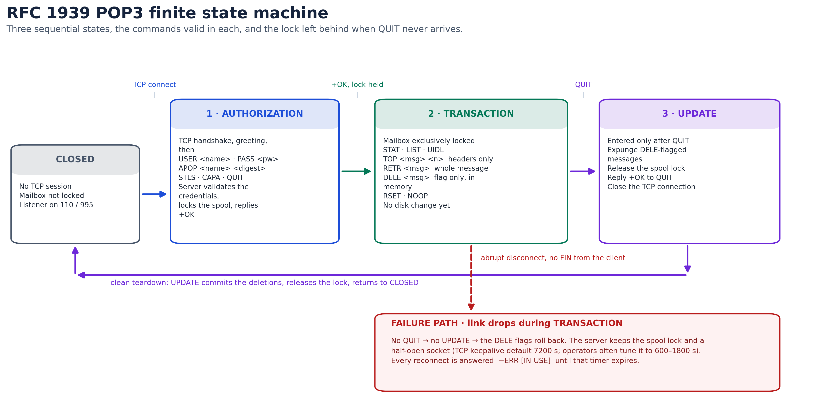

# COMPUTER NETWORKS (BACSE203)

## CASE STUDY REPORT

### Case Study 5 — POP3 Mailbox Access in a Low-Bandwidth Branch

**School of Computer Science and Engineering (SCOPE)**  
**Vellore Institute of Technology**

Class ID: **VL2026270101688** (B2 + TB2 slot) · **Fall Semester 2026–27**

| Field | Detail |
| :--- | :--- |
| Case Study Number | 5 |
| Case Study Title | POP3 Mailbox Access in a Low-Bandwidth Branch |
| Team Number | Team 5 |
| Course Instructor | *(to be completed)* |
| Date of Submission | October 2026 |

### Team details

| Registration Number | Name of the student | Role |
| :--- | :--- | :--- |
| 25BCE0337 | Pratik Ambastha | Simulation and packet-analysis specialist |
| 25BCE0344 | Arunya Srivastava | Lead protocol analyst and FSM architect |
| 25BCE0401 | Adarsh Kumar Singh | WAN systems and workflow architect |
| 25BCE0998 | Pranjal Paul | Cybersecurity and threat analyst |
| 25BCE2004 | Bhavya Singh | Standards, benchmarks and quality lead |
| 25BBS0046 | Shriyansh Gangwar | Simulation and packet-analysis specialist |

---

## Contents

1. [Case study overview](#1-case-study-overview)
2. [Technologies and protocols studied](#2-technologies-and-protocols-studied)
3. [Standards, RFCs and official documentation](#3-standards-rfcs-and-official-documentation)
4. [Research findings](#4-research-findings)
5. [Implementation, simulation and demonstration](#5-implementation-simulation-and-demonstration)
6. [Answers to the assigned case-study questions](#6-answers-to-the-assigned-case-study-questions)
7. [Conclusion](#7-conclusion)
8. [References](#8-references)
9. [Appendix A — Reproducing the experiment](#appendix-a--reproducing-the-experiment)

---

## 1. Case study overview

### 1.1 Background

A remote branch of an enterprise — an offshore platform, a mining site, a rural clinic or a field office — depends on a Wide Area Network backhaul that is narrow, slow and unreliable. The branch in this case study is connected by a geostationary satellite (VSAT) link with the following measured operating envelope:

| Parameter | Value | Consequence |
| :--- | :--- | :--- |
| Throughput | 256 kbps (token-bucket limited) | a 3 MiB attachment occupies the link for over two minutes |
| Round-trip time | 450 ms | every protocol turn costs almost half a second |
| Loss | 5 % random drop, plus rain-fade outages | TCP throughput collapses and sessions die mid-transfer |
| Mailbox | five messages, 5,803,004 octets total | one 1.89 MB message carries the bulk of the traffic |

Email remains the branch's operational lifeline: shift rosters, supply manifests, inspection reports and engineering drawings all arrive by mail. The enterprise runs a central mail server at headquarters (Dovecot for POP3/POP3S, Postfix for SMTP). The branch retrieves mail with the Post Office Protocol version 3 (POP3, RFC 1939) over TCP port 110.

POP3 was designed in 1996 for personal computers on intermittent dial-up lines. It assumes that a mailbox is small, that the client is the only device, that the link is reasonably fast, and that a retrieval either completes or is restarted. None of those assumptions hold for a modern branch on a VSAT link, and the result is a protocol that is simultaneously slow, fragile and insecure.

### 1.2 Problem statement

The branch cannot reliably read its mail because POP3's design conflicts with the link's physics in four measurable ways.

1. **Monolithic retrieval.** `RETR` returns the whole message — headers, body and every MIME attachment — with no way to ask for a part. Base64 encoding inflates a 3 MiB PDF to 4.11 MiB on the wire (+36.84 %), which needs 134.5 s at the full 256 kbps and about 138 s once TCP/IP framing is counted. During that window every other branch application is starved.
2. **No resumption.** `RETR` has no byte-offset parameter. If the link fails at 41 % — the failure reproduced in this report — the 781 kB already delivered is discarded and the next attempt starts at byte zero. On a link that flaps every few minutes, large messages may never complete.
3. **Exclusive lockout.** POP3 locks the maildrop for the whole TRANSACTION state and releases it only when the client sends `QUIT`. A link failure leaves the server holding the lock and a half-open socket. Until the TCP keepalive timer expires (7200 s by default on Linux; 600–1800 s in many deployments), every reconnect is answered `-ERR [IN-USE]`. The branch is denied its own mailbox by its own abandoned session.
4. **Non-atomic deletion.** `DELE` only marks a message in memory; the physical delete happens in the UPDATE state after `QUIT`. A dropped session rolls the marks back, so the same message is delivered again and the scarce airtime is spent twice.

A fifth problem cuts across all four: the protocol is cleartext. `USER` and `PASS` cross the satellite hop, the ground station and any intervening network as readable ASCII, and nothing in the protocol authenticates the server or protects message integrity.



*Figure 1 — The four failure modes, with the quantities derived in §4.*

### 1.3 Objectives

1. **Deconstruct the protocol.** Explain POP3's command set, its three-state finite state machine and the exact mechanism behind each failure mode, using RFC 1939 as the primary source.
2. **Quantify the link.** Model the bandwidth-delay product, Base64 expansion and TCP throughput under 5 % loss, so that each claim in the report is a number that can be checked rather than an adjective.
3. **Design a resilient workflow.** Specify a five-tier branch email architecture that decouples the user from the WAN and removes the four failure modes without changing the HQ mail server.
4. **Harden the access path.** Threat-model legacy POP3 access, explain why APOP does not solve it, and define a migration to TLS 1.3, modern token authentication and DMZ segmentation.
5. **Prove the behaviour experimentally.** Build a reproducible packet-level experiment that shows cleartext authentication, a 256 kbps bulk transfer, a link blackout at 41 %, and the resulting `-ERR [IN-USE]` lockout — and publish the capture so the result can be re-checked.

### 1.4 Scope

**In scope.** POP3 and POP3S (RFC 1939, RFC 2595, RFC 8314); IMAP4rev1 and SMTP as comparators; MIME and Base64 overhead (RFC 2045); TCP behaviour over a high-latency, lossy path; the POP3 state machine and its failure modes; a branch store-and-forward proxy design; a reproducible socket-level experiment with Wireshark analysis; and the security controls (TLS 1.3, SASL OAuth, DMZ filtering) that remediate the findings.

**Out of scope.** RF link budgeting and antenna alignment; transponder modulation and forward-error-correction hardware; proprietary groupware protocols (MAPI/ActiveSync); mail-client user-interface design; and a production deployment of the proposed proxy. The experiment emulates the link's application-level behaviour, not its radio physics.

### 1.5 Key networking concepts

- **Application-layer paradigms.** Client–server dialogue, stateful versus stateless protocols, and the command/reply grammar (`+OK` / `-ERR`) that POP3 inherits from SMTP.
- **Mail architecture.** The division of labour between the MUA (Thunderbird, Outlook), the MTA (Postfix), the MDA (Dovecot) and the maildrop; push delivery with SMTP versus pull retrieval with POP3 or IMAP.
- **MIME encoding.** `Content-Type`, `Content-Transfer-Encoding`, multipart boundaries, and the 3-bytes-to-4-characters expansion of Base64 plus the CRLF line wrapping mandated by RFC 2045.
- **Transport dynamics.** The three-way handshake, slow start, retransmission timeout backoff, the bandwidth-delay product, and the Mathis formula for steady-state TCP throughput under loss.
- **Network security.** TLS 1.3 and AEAD cipher suites, implicit TLS on port 995 versus in-band `STLS`, certificate validation, SASL OAuth, DMZ design and stateful ACLs.

---

## 2. Technologies and protocols studied

**Table 2 — Protocols relevant to branch mail access.**

| Technology / Protocol | Purpose | Important features | Advantages | Limitations |
| :--- | :--- | :--- | :--- | :--- |
| **POP3** (RFC 1939) | Retrieves a mailbox from a server to a client | TCP 110; AUTHORIZATION / TRANSACTION / UPDATE; `USER`, `PASS`, `APOP`, `STAT`, `LIST`, `UIDL`, `TOP`, `RETR`, `DELE`, `QUIT`; `+OK` / `-ERR` replies | Minimal server state; simple to implement; works offline once downloaded | Whole-message `RETR`; no byte-range resume; exclusive lock; deletion is not atomic; cleartext by default |
| **IMAP4rev1** (RFC 3501) | Remote mailbox manipulation with server-side state | TCP 143/993; per-message flags; folders; `FETCH BODY[]`, `BODYSTRUCTURE`, `SEARCH`; IDLE | Multi-device flag sync; selective body-part fetch; server-side search | Chatty: many round trips; each turn costs 450 ms here; clients often pre-fetch bodies anyway |
| **SMTP / ESMTP** (RFC 5321) | Push mail between MUAs and MTAs, and MTA to MTA | TCP 25 relay, 587 submission; `EHLO`, `MAIL FROM`, `RCPT TO`, `DATA`; store-and-forward queue | Universal; built-in spooling and retry absorb outages | Push-only; legacy port 25 is unauthenticated; no retrieval |
| **POP3S** (RFC 2595, RFC 8314) | POP3 wrapped in TLS | Implicit TLS on 995, or `STLS` on 110; TLS 1.3 | Confidentiality, integrity and server authentication | Adds a handshake RTT; does not fix POP3's application-layer design |
| **MIME** (RFC 2045–2049) | Extends RFC 5322 mail to binary parts and character sets | `multipart/mixed`, `multipart/alternative`; Base64 and quoted-printable; boundary strings | Carries any file type over 7-bit transport | Base64 adds 33.3 % by construction and 36.8 % with CRLF wrapping |

---

## 3. Standards, RFCs and official documentation

**Table 3 — Primary standards consulted.**

| Standard / RFC | What was studied | Relevance to the case | Source (accessed 23 Oct 2026) |
| :--- | :--- | :--- | :--- |
| **RFC 1939** — Post Office Protocol v3 | The three states, every command, reply codes, APOP, and the rule that deletion commits only in UPDATE | Defines the exact mechanics behind all four failure modes | https://www.rfc-editor.org/rfc/rfc1939 |
| **RFC 2595** — Using TLS with IMAP, POP3 and ACAP | `STLS` negotiation, implicit TLS on 995, certificate checks | Basis for the POP3S remediation and its limitations | https://www.rfc-editor.org/rfc/rfc2595 |
| **RFC 8314** — Cleartext Considered Obsolete | IETF's current position: implicit TLS on 995 is the norm, cleartext access is deprecated; updates RFC 1939 and RFC 2595 | Justifies decommissioning port 110 rather than merely offering `STLS` | https://www.rfc-editor.org/rfc/rfc8314 |
| **RFC 3501** — IMAP4rev1 | Selective fetch, server-side flags, disconnected operation | The comparator used to judge POP3's design and the migration target | https://www.rfc-editor.org/rfc/rfc3501 |
| **RFC 5321** — SMTP | Relay model, queueing, 4xx/5xx semantics | Explains why outbound spooling survives an intermittent link | https://www.rfc-editor.org/rfc/rfc5321 |
| **RFC 2045 / 2049** — MIME | Base64, 76-character lines, CRLF, multipart boundaries | Source of the 36.84 % inflation measured in §4.1 | https://www.rfc-editor.org/rfc/rfc2045 |
| **RFC 7233** — HTTP Range Requests | Byte-range retrieval as a contrast | Shows what POP3 lacks: resumable transfer | https://www.rfc-editor.org/rfc/rfc7233 |
| **RFC 9293** — TCP | Handshake, RTO backoff, keepalive, window scaling | Explains the half-open session that holds the lock | https://www.rfc-editor.org/rfc/rfc9293 |
| **RFC 8446** — TLS 1.3 | 1-RTT handshake, AEAD-only cipher suites | Defines the transport used by the hardened design | https://www.rfc-editor.org/rfc/rfc8446 |
| **RFC 7628** — SASL mechanisms for OAuth | `OAUTHBEARER`; bearer tokens over SASL | Basis for replacing static passwords with short-lived tokens | https://www.rfc-editor.org/rfc/rfc7628 |

> **Note on XOAUTH2.** Many vendor documents describe “XOAUTH2 (RFC 7628)”. RFC 7628 actually standardises the **`OAUTHBEARER`** mechanism; XOAUTH2 is the earlier, vendor-specific mechanism that it generalises. This report therefore specifies `OAUTHBEARER` and treats XOAUTH2 as a legacy deployment detail.

---

## 4. Research findings

### 4.1 Base64 inflation is 36.84 %, and it costs 138 seconds

Base64 maps every 3 binary octets (24 bits) to 4 ASCII characters (32 bits), an unavoidable 33.33 % expansion. RFC 2045 then requires lines of at most 76 characters terminated by CRLF, which adds two octets per line:

$$
\text{encoded} = 4 \times \left\lceil \frac{3{,}145{,}728}{3} \right\rceil = 4{,}194{,}304 \text{ bytes}
$$

$$
\text{lines} = \left\lceil \frac{4{,}194{,}304}{76} \right\rceil = 55{,}189 \quad\Rightarrow\quad
\text{on the wire} = 4{,}194{,}304 + 2 \times 55{,}189 = 4{,}304{,}682 \text{ bytes}
$$

That is **4.105 MiB (4.305 MB)**, an expansion of **36.84 %** over the 3 MiB original. At 256 kbps the raw transfer takes **134.5 s**; allowing roughly 2.7 % for TCP/IP headers gives the **≈138 s** figure used throughout this report.

The lesson is not that Base64 is badly designed — it is that a mail system which transfers whole messages will always pay this tax, at exactly the moment the link can least afford it.

### 4.2 The link is bandwidth-limited, not window-limited

The bandwidth-delay product is small:

$$
\text{BDP} = 256{,}000 \times 0.45 = 115{,}200 \text{ bits} = 14{,}400 \text{ bytes} \approx 9.9 \text{ MSS}
$$

With an MSS of 1460 bytes, roughly ten segments fill the pipe. That matters for the analysis: at 256 kbps, window scaling and receive-buffer tuning are **not** the binding constraint — the link is. Long-lived TCP can fill this pipe with the default 64 kB window.

Loss is the real problem. Applying the Mathis formula for steady-state throughput,

$$
T \le \frac{\text{MSS}}{\text{RTT}} \cdot \frac{1}{\sqrt{p}}
= \frac{1460 \times 8}{0.45} \cdot \frac{1}{\sqrt{0.05}}
\approx 116 \text{ kbps}
$$

a 5 % random drop rate cuts throughput to about **45 % of the line rate**, so the 4.30 MB message takes **≈297 s** instead of 134.5 s. POP3 compounds this because every command waits a full round trip: `USER`, `PASS`, `STAT`, `LIST`, `UIDL`, `TOP`, `RETR` and `QUIT` cost about 3.6 s before any payload moves. The protocol's chattiness is cheap on a LAN and expensive on a satellite.

### 4.3 The lock is the availability failure

RFC 1939 requires that a mailbox be exclusively locked for the TRANSACTION state. Implementations use `flock`/`fcntl` and, on some systems, dotlock files. The lock is released when the session ends cleanly — that is, after `QUIT`.

A VSAT fade does not send `QUIT`, and often does not send `FIN` or `RST` either. The server's socket remains `ESTABLISHED`; the lock remains held. On Linux the default keepalive probe interval is 7200 s, and many operators tune it to 600–1800 s to bound the damage. In the experiment in §5, the lockout was still in force ten seconds after the blackout, exactly as the design predicts; a production server would hold it for minutes.

The operational consequence is counter-intuitive: the branch's own failed session is what denies the branch its mail. This is a self-inflicted denial of service, not an external attack.

### 4.4 Deletion is not atomic, so duplicates are structural

`DELE` does not delete. It marks a message for deletion in the server's volatile state; the UPDATE state, entered only after `QUIT`, performs the unlink. If the session dies first, the marks are discarded to protect the mail. The client, having already downloaded the message, has no way to tell the server “I got it”. On reconnect the message is offered again.

There is no POP3 mechanism for server-side read/unread flags. A client configured to “leave mail on server” will re-download everything it has already seen, and two devices using the same mailbox cannot agree on what has been read. This is the limitation that IMAP was created to solve.

### 4.5 Security: cleartext today, APOP yesterday

On port 110 the entire dialogue is 7-bit ASCII. The `PASS` line is readable by any passive observer on the path — a compromised ground station, a transit provider, or a shared segment at the branch. The experiment in §5 captures the password in a 22-byte TCP payload; no decoding is required.

APOP (RFC 1939 §7) replaces the password with `MD5(timestamp || shared-secret)`. It avoids sending the password, but it is not a solution:

- MD5 is cryptographically broken for collision resistance and is deprecated for any security use.
- The digest is computed over a timestamp and a low-entropy human password, which makes **offline dictionary attacks** practical: an attacker who captures one challenge and response can test candidate passwords locally at high speed.
- APOP authenticates the client to the server, never the server to the client. It offers no protection against a rogue server or a man-in-the-middle.
- It provides no forward secrecy, no multi-factor authentication and no revocation.
- The timestamp is the only replay defence, and its window is implementation-defined.

The correct conclusion is not “use APOP”; it is “move the authentication into TLS and replace the password with a token”.

---

## 5. Implementation, simulation and demonstration

### 5.1 Tooling and experimental setup

**Table 4 — Experimental parameters.**

| Item | Value |
| :--- | :--- |
| Packet analysis | Wireshark / tshark **4.7.4** |
| Protocol harness | Python **3.14.8**, standard-library sockets only |
| Operating system | EndeavourOS (Arch), Linux **6.18.57** |
| Topology | MUA → user-space WAN emulator `127.0.0.1:1110` → POP3 server `127.0.0.1:1111` |
| Emulated link | 256 kbps token bucket; 225 ms one-way delay for each control turn (≈450 ms POP3 RTT); bulk data paced at link rate |
| Failure injection | Link blackout after 781 kB of `RETR 4` (41.4 %); sockets left half-open, no FIN or RST |
| Mailbox | 5 messages: 12,288 + 87,040 + 460,800 + 1,887,436 + 3,355,440 = **5,803,004 B** |
| Test sequence | `USER`, `PASS`, `STAT`, `LIST`, `UIDL`, `TOP 4 0`, `RETR 4`, blackout, reconnect, `USER`, `PASS` |
| Capture | `captures/pop3_wan_capture.pcapng`, 1,239 packets, 35.98 s |

**What is and is not emulated.** The emulator shapes the application dialogue and the data rate, so the transfer duration, the byte counts and the protocol turns are real measurements of this run. It does **not** reproduce radio-layer propagation at the TCP level: the TCP handshake terminates on loopback in microseconds. The 450 ms figure therefore applies to the POP3 command/response turn, which is what a user experiences, and not to the SYN/SYN-ACK exchange. This limitation is stated here rather than hidden; a root-level `tc netem` setup on a veth pair would remove it, but it was not available in the lab environment.

### 5.2 Topology



*Figure 2 — Branch, WAN and HQ zones. The edge gateway is the only branch device that speaks to the WAN; the MUA never does.*

### 5.3 Results

The captured conversation is internally consistent and reproduces the transfer, resumption and lockout failure modes of §1.2.

| Observation | Measured value |
| :--- | :--- |
| POP3 command/response turn | 451 ms (e.g. `USER` at 0.226 s, `+OK` at 0.677 s) |
| `TOP 4 0` reply | **366 bytes** of headers and terminator (394 bytes of POP3 payload once the `+OK` line is included) |
| `RETR 4` payload before blackout | **779,092 bytes** received by the client (781,360 B had been forwarded; the difference was in flight) |
| Transfer window | 3.163 s → 27.607 s = **24.44 s** |
| Measured throughput | **255.0 kbps** on a 256 kbps shaper (99.6 % of line rate) |
| Blackout point | **41.4 %** of the 1,887,436-byte message |
| Projected full transfer | **59.0 s** at 256 kbps |
| Reconnect rejection | `-ERR [IN-USE]` at 37.741 s, 451 ms after `PASS` |



*Figure 3 — Cumulative payload delivered to the client. The measured slope is the shaper's 256 kbps; the dashed line projects the remainder that was never delivered.*

**Table 5 — Frame-level evidence (client-side TCP stream, port 32894 → 1110).** Frame numbers refer to the shipped capture; a fresh run reproduces the behaviour but not the exact numbering.

| Frame | Time (s) | Direction | Protocol / flags | What it proves |
| ---: | ---: | :--- | :--- | :--- |
| 1–3 | 0.000 | client ⇄ proxy | SYN, SYN-ACK, ACK | TCP connection established |
| 9 | 0.226 | proxy → client | `+OK BACSE203 lab POP3 server ready` (36 B) | server greeting |
| 11 | 0.226 | client → proxy | `USER branch_user1` | username in cleartext |
| 17 | 0.677 | proxy → client | `+OK User accepted` | 451 ms turn |
| 18 | 0.677 | client → proxy | `PASS SecretP@ss2026!` (22 B payload) | **password in cleartext** |
| 23 | 1.128 | proxy → client | `+OK Logged in. Mailbox spool locked exclusively.` | lock acquired; 451 ms turn |
| 24 / 29 | 1.128 / 1.579 | client ⇄ proxy | `STAT` / `+OK 5 5803004` | 5 messages, 5.53 MiB |
| 30 / 35 | 1.579 / 2.030 | client ⇄ proxy | `LIST` / per-message sizes | RETR 4 is 1,887,436 B |
| 42 | 2.483 | client → proxy | `TOP 4 0` (9-byte command) | header-only request |
| 47 | 2.937 | proxy → client | `+OK top of message follows` + headers | 366-byte reply body (363 B headers + terminator), 99.98 % smaller than `RETR` |
| 48 / 57 | 2.937 / 3.163 | client ⇄ proxy | `RETR 4` / `+OK 1887436` and the first 1,460-byte segment | bulk transfer starts |
| 1205 | 27.607 | proxy → client | 1,460 B data | last RETR payload frame; 779,092 B received in total |
| 1208 | 30.119 | proxy → server | `[TCP ZeroWindow]` | proxy stopped reading; the server blocks with the socket still open |
| 1209 | 36.613 | client → proxy | SYN | reconnect after the client's 8 s read timeout |
| 1235 | 37.741 | proxy → client | `-ERR [IN-USE] Mailbox is locked by another session!` (53 B) | **lockout caused by the orphaned session** |

The capture also retains TCP keepalive probes from the server toward the orphaned connection (frames 1207 and 1225), which is the mechanism that eventually reclaims the lock in a production deployment.

**Wireshark evidence (v4.6.9, full-screen views of the shipped capture).**



*Screenshot 1 — Display filter `pop` (556 frames shown, count verified against `tshark`): the complete USER/PASS/STAT/LIST/UIDL/TOP/RETR dialogue decoded on TCP port 1110.*



*Screenshot 2 — `tcp.flags.syn == 1 && tcp.port == 1110`: the handshakes of both client sessions.*



*Screenshot 3 — Follow TCP Stream, first session: login, `TOP 4 0`, then `RETR 4` truncated at 41.4 % by the link blackout.*



*Screenshot 4 — Follow TCP Stream, reconnect: `PASS` answered 451 ms later with `-ERR [IN-USE]` — the orphaned session still holds the exclusive mailbox lock.*

### 5.4 Design of the resilient workflow



*Figure 4 — The five tiers. Tier 1 removes the WAN from the interactive path; Tiers 2–5 make the WAN traffic small, compressed, encrypted and deferrable.*

**Tier 1 — Local edge gateway.** A small server at the branch runs Dovecot as a local IMAP cache and a polling daemon (Fetchmail, or an equivalent) toward HQ. The MUA talks only to the LAN. Reading, searching and drafting no longer depend on the satellite; the WAN becomes a background synchronisation problem.

**Tier 2 — Two-phase header pre-fetch.** The daemon issues `UIDL` to learn which messages are new (UIDLs are stable across sessions, unlike message numbers), then `TOP <msg> 0` for each new message. In the experiment this returned the full envelope — From, To, Subject, Date, Message-ID, MIME headers — in **366 bytes** for the 1.89 MB message, a 99.98 % reduction relative to `RETR`. For the five-message spool the envelope cost is under 2 kB. `LIST` already provides octet sizes, so the proxy can classify a message before fetching anything else.

> `TOP` is an optional POP3 command. Dovecot implements it; a server that does not would force a fallback to `LIST` plus a size policy, or a migration to IMAP. The design should probe `CAPA` and degrade gracefully rather than assume `TOP` exists.

**Tier 3 — Attachment and size policy.** Messages below 100 kB are fetched immediately. Larger messages, or any message with a `multipart/mixed` attachment, stay at HQ; the proxy inserts a locally generated stub (“Attachment held at HQ: blueprints.pdf, 2.4 MB — fetch on demand”). The user triages on metadata, and the expensive bytes move only when they are actually needed, preferably in an overnight window.

**Tier 4 — Compression and transport tuning.** The WAN leg runs TLS 1.3 on port 995 with gzip at the application layer, SACK (RFC 2018) and keepalives tuned to detect dead peers in minutes rather than hours. Compression is effective on text and Base64 alike: Base64 output is not random, and gzip typically removes 60–70 % of a typical mail stream. TLS 1.3 also reduces the handshake to one round trip, which matters at 450 ms.

**Tier 5 — Outbound spooling.** A local Postfix instance accepts the user's mail over the LAN, writes it to a durable queue and returns success immediately. Delivery to HQ uses exponential backoff with jitter, so a flap delays mail instead of losing it or blocking the user's client.

**Synchronisation state.** The proxy keeps a small SQLite database mapping `UIDL → local message-id`, plus the byte offset of any partially fetched body. Because UIDLs are stable, a reconnect can tell “new” from “already seen” without re-downloading, which is the piece POP3 itself lacks.

### 5.5 Comparative analysis

**Table 6 — Modelled cost per mailbox check (five messages, 5.53 MiB spool).**

| Metric | Legacy POP3 :110 | IMAP4rev1 :143 | Proposed edge-cached workflow |
| :--- | :--- | :--- | :--- |
| Bytes across the WAN | 5,803,004 B (5.53 MiB) | ≈6.0 kB of envelopes and flags | ≤1.83 kB of envelopes (5 × 366 B) |
| WAN time | ≈185 s (181.3 s transfer + 8 turns) | ≈5.6 s | ≈2.8 s in the background |
| Time until the user sees the inbox | ≈185 s | ≈5.6 s (still WAN-bound) | **<0.1 s locally** |
| Recovery after a mid-transfer drop | 0 % — restart at byte 0 | ≈35 % — depends on client cache | **100 %** — local store + resumable queue |
| Mailbox lockout on disconnect | Severe: 10–30 min | Moderate: server session timeout | **None** — the MUA never holds a WAN session |
| Wire security | None (cleartext) | Optional `STARTTLS` | TLS 1.3 required on :995 |
| Multi-device read state | Unsupported | Supported (server flags) | Supported through the local IMAP cache |

*The IMAP and edge figures are modelled from the measured 255 kbps payload rate and the RFC command counts; they were not separately benchmarked. The POP3 figure is measured.*

The design does not pretend that POP3 can be fixed at the protocol level. It removes POP3 from the interactive path: the user talks IMAP to a local server, and the WAN carries a small, encrypted, deferrable stream of headers and queued bodies.

---

## 6. Answers to the assigned case-study questions

### 6.1 Question (a) — Explain POP3 and its limitations

**Protocol architecture.** POP3 is an application-layer, text-based, client–server protocol standardised in RFC 1939 (STD 53). The client opens a TCP connection to the server, normally on port 110, or on port 995 when the connection is wrapped in TLS. The server greets with `+OK`; the client sends four-character commands terminated by CRLF; the server replies with a status line beginning `+OK` (success) or `-ERR` (failure), followed where appropriate by a multi-line response terminated by a line containing a single period.

**The three-state finite state machine.**



*Figure 5 — RFC 1939 state machine, with the failure path that produces the lockout.*

1. **AUTHORIZATION.** After the TCP handshake the server sends its greeting. The client authenticates with `USER`/`PASS`, with `APOP`, or by upgrading the connection with `STLS` and then authenticating inside TLS. On success the server acquires an exclusive lock on the maildrop and enters TRANSACTION.
2. **TRANSACTION.** The client interrogates and retrieves the mailbox: `STAT` (count and total octets), `LIST` (per-message octets), `UIDL` (persistent identifiers), `RETR` (whole message), `TOP` (headers plus *n* body lines), `DELE` (mark for deletion), `RSET` (clear marks), `NOOP`. Deletions exist only in the server's memory during this state.
3. **UPDATE.** Entered only when the client sends `QUIT`. The server expunges the messages marked with `DELE`, commits the mailbox, releases the lock, replies `+OK` and closes the connection. If the session ends any other way, the marks are rolled back.

**Limitations.**

- **Monolithic retrieval.** `RETR` has no notion of MIME parts. The client cannot ask for the text body while deferring a 3 MiB attachment; it receives the whole 4.11 MiB encoded message or nothing. On a 256 kbps link that is 134.5 s of exclusive use, and roughly 138 s once framing is counted.
- **No byte-range resumption.** Unlike HTTP's `Range` header or FTP's `REST`, `RETR` always starts at offset zero. A failure at 41 % discards 781 kB. On a link that flaps, a large message can enter a permanent retry loop.
- **Exclusive locking.** The lock is correct for mailbox integrity and disastrous for availability. A half-open socket keeps it held until keepalive expires; reconnects get `-ERR [IN-USE]`.
- **Non-atomic deletion and duplicates.** Because deletion commits only in UPDATE, an interrupted session causes redelivery. Because POP3 has no server-side read flags, “leave on server” causes the same thing even without a failure.
- **Client-side storage as a single point of failure.** The download-and-delete model leaves the only copy in a local `.PST` or mbox file, which is vulnerable to disk failure and corruption. Server-side backup does not help if the server copy was deleted.
- **Poor behaviour on a long, lossy path.** The protocol is a sequence of request/response turns; each costs 450 ms here. TCP throughput at 5 % loss falls to about 116 kbps, and the protocol has no application-level resumption to work around it.
- **Cleartext by default.** Port 110 exposes credentials and content. APOP replaces the password with an MD5 digest but is itself obsolete (§4.5).

### 6.2 Question (b) — Design an appropriate email-access workflow

The workflow in §5.4 is the answer; it is summarised here as a sequence.

```
Branch MUA                Branch edge proxy                  HQ maildrop
    |                            |                                 |
    |-- IMAP over LAN --------->|                                 |
    |   (<1 ms, local cache)     |-- TLS 1.3 :995, gzip ---------->|
    |                            |-- UIDL ------------------------>|
    |                            |<-- UID list --------------------|
    |                            |-- TOP n 0 --------------------->|
    |                            |<-- 366 B envelope --------------|
    |<-- header + stub ----------|                                 |
    |                            |   [message >= 100 kB: held]     |
    |-- user clicks "fetch" ---->|                                 |
    |                            |-- RETR n (queued, resumable) -->|
    |                            |<-- body, compressed ------------|
    |<-- full message -----------|                                 |
    |                            |                                 |
    |-- outbound SMTP ---------->|-- local Postfix queue --------->|
    |   (accepted instantly)     |   backoff + jitter over WAN     |
```

The five tiers, restated:

1. **LAN isolation.** The MUA talks to a local Dovecot instance. Interactive latency is the LAN's, not the satellite's.
2. **Header pre-fetch.** `UIDL` + `TOP n 0` move envelopes only — 366 bytes for a 1.89 MB message in the experiment.
3. **Attachment policy.** Small messages sync automatically; large parts stay at HQ behind a stub and move on demand or overnight.
4. **Compression and TLS.** TLS 1.3 on 995 with gzip, SACK and tuned keepalives; 60–70 % less data and a one-round-trip handshake.
5. **Outbound spooling.** Local Postfix accepts mail instantly and retries with exponential backoff and jitter.

Two design details make the difference between a diagram and a system:

- **A UIDL-keyed state database.** UIDLs are stable across sessions; message numbers are not. The proxy records `UIDL → local id` and the offset of any partial body, so a reconnect resumes instead of restarting.
- **A size policy driven by `LIST`.** The proxy does not need to `RETR` a message to know it is 3.35 MB; `LIST` says so in one small response. The policy can therefore be applied before any expensive transfer.

**Why not simply switch to IMAP?** IMAP fixes flag synchronisation and selective fetch, but a stock IMAP client on a 450 ms link is still interactive: opening a folder, searching or previewing a message each costs round trips, and many clients pre-fetch bodies. IMAP is the right long-term protocol, and the proposed architecture uses it on the LAN. It is not a substitute for a local cache on this link.

### 6.3 Question (c) — Analyse the security and reliability concerns of legacy mail access

**A. Security threats.**

1. **Credential sniffing.** Port 110 sends `USER` and `PASS` as ASCII. The experiment captures the password in a single 22-byte payload; any passive tap on the satellite path, the ground station or a branch segment recovers it without cryptanalysis. The same tap recovers message content.
2. **APOP is not a fix.** `MD5(timestamp || secret)` avoids sending the password, but MD5 is deprecated, the digest is open to offline dictionary attack, there is no server authentication, no forward secrecy, no MFA and no revocation. It protects one secret from one attack and nothing else.
3. **No server authentication or integrity.** Nothing in POP3 proves that the server is the enterprise's. DNS spoofing, BGP hijacking or a rogue maildrop can redirect the branch and alter messages; the client cannot tell.
4. **No modern identity.** Static passwords cannot be bound to device health, location or a second factor, and a stolen password gives persistent access until someone changes it.
5. **Attachment delivery without inspection.** A cleartext POP3 path delivers weaponised attachments straight to the branch endpoint; any filtering must happen upstream, at HQ.
6. **Metadata exposure.** Even with TLS, the traffic pattern reveals when the branch polls, how many messages it has and how large they are. On a dedicated VSAT link this is visible to the provider.

**B. Reliability failure modes.**

1. **Lock freeze.** A half-open socket keeps the maildrop locked. The experiment shows the rejection ten seconds after the blackout; a production keepalive of 600–1800 s turns this into a 10–30 minute outage.
2. **Duplicate delivery.** Uncommitted `DELE` marks roll back, so the same message is fetched again. With a 3 MiB attachment, one duplicate costs another 138 s of link time.
3. **Local storage fragility.** Download-and-delete leaves the only copy in a local file. A disk failure or a power cut during a write can destroy the archive.
4. **No resumable state.** A failed `RETR` leaves nothing reusable; the next attempt starts from zero.

**C. Hardening blueprint.**

1. **Transport.** Decommission port 110. Require POP3S on 995 with TLS 1.3 (RFC 8446) and AEAD suites (`TLS_AES_256_GCM_SHA384`, `TLS_CHACHA20_POLY1305_SHA256`), with certificate validation against the enterprise PKI. This follows RFC 8314's position that cleartext mail access is obsolete.
2. **Authentication.** Replace static passwords with SASL `OAUTHBEARER` (RFC 7628) against the enterprise identity provider, issuing short-lived tokens protected by MFA. XOAUTH2 may remain as a compatibility path but should not be the target.
3. **Segmentation.** Put the mail servers in a DMZ behind a stateful firewall that permits only 995/tcp from the branch's static address, and rate-limits authentication attempts. The internal transaction network must not be reachable from the DMZ.
4. **Content controls.** Filter and sandbox attachments at HQ, before they enter the branch retrieval queue; disarm macro-bearing documents and executables (CDR) rather than relying on the endpoint.
5. **Logging and detection.** Log authentication failures, lock contention, repeated `RETR` of the same message and unusual message sizes. These are the observable signs of both attacks and the failure modes above.
6. **Residual risk and migration.** TLS 1.3 plus tokens fixes confidentiality, integrity and identity, but POP3 still downloads whole messages and still locks the mailbox. The durable fix is the edge cache with IMAP on the LAN, followed by retirement of POP3 at the branch. Until then, the proxy bounds the damage: the MUA never holds a WAN session, so a link failure cannot lock the user out.

---

## 7. Conclusion

POP3 is a small, well-specified protocol that solved the problem of its time: retrieving mail over an unreliable telephone line to a single personal computer. This case study shows why that design fails on a 256 kbps, 450 ms, 5 %-loss satellite link, and it quantifies each failure rather than asserting it.

The measurements are unambiguous. A 3 MiB PDF becomes 4.11 MiB on the wire (+36.84 %) and takes 134.5 s at line rate, about 138 s with framing, and close to 297 s when 5 % loss drives TCP down to 116 kbps. A `RETR` cut at 41 % discarded 781 kB and restarted from zero. The abandoned session left the mailbox locked, so the reconnect ten seconds later was rejected with `-ERR [IN-USE]`. The password crossed the link in a 22-byte cleartext payload, and APOP — the protocol's only cryptographic option — is built on a broken hash and offers no server authentication, no forward secrecy and no MFA.

The proposed five-tier workflow addresses the causes rather than the symptoms. Local caching removes the WAN from the interactive path; `UIDL` plus `TOP n 0` reduces a 1.89 MB message to a 366-byte envelope; the attachment policy defers the expensive bytes until they are wanted; TLS 1.3 with compression shrinks and protects what remains; and local outbound spooling turns a link failure into a delay rather than an error. The modelled comparison puts a mailbox check at 1.83 kB and 2.8 s of background WAN time instead of 5.53 MiB and 185 s, with no lockout hazard.

The security work is equally concrete: retire port 110, require TLS 1.3 with AEAD on 995, replace passwords with short-lived OAuth tokens, and put the mail servers in a DMZ with a single permitted inbound flow. None of that fixes POP3's monolithic retrieval, which is why the architecture keeps POP3 at the edge and gives the user IMAP on the LAN.

**Recommended roadmap.**

- **Immediate (0–3 months).** Deploy the branch edge proxy; enforce TLS 1.3 on 995; disable port 110; tune keepalives to 300 s; enable attachment stubs and outbound spooling.
- **Medium term (3–12 months).** Move mailboxes to IMAP4rev1 with server-side flags and an offline cache; retire POP3 for user access; integrate `OAUTHBEARER` with the identity provider and require MFA.
- **Long term (12+ months).** Adopt SD-WAN with forward error correction and link bonding across satellite and LTE, so that the branch is no longer single-homed on a fading link; add centralised CDR and mail-flow analytics.

The broader lesson is that protocol choice is a function of the link. POP3 is not “wrong”; it is wrong here. The engineering task is to recognise the mismatch, measure it, and put a layer in front of it that turns the link's physics into a background concern.

---

## 8. References

All URLs were accessed on 23 October 2026.

[1] J. Myers and M. Rose, “RFC 1939: Post Office Protocol — Version 3,” IETF, May 1996. https://www.rfc-editor.org/rfc/rfc1939

[2] C. Newman, “RFC 2595: Using TLS with IMAP, POP3 and ACAP,” IETF, June 1999. https://www.rfc-editor.org/rfc/rfc2595

[3] K. Moore and C. Newman, “RFC 8314: Cleartext Considered Obsolete — Use of TLS for Email Submission and Access,” IETF, January 2018. https://www.rfc-editor.org/rfc/rfc8314

[4] M. Crispin, “RFC 3501: Internet Message Access Protocol — Version 4rev1,” IETF, March 2003. https://www.rfc-editor.org/rfc/rfc3501

[5] J. Klensin, “RFC 5321: Simple Mail Transfer Protocol,” IETF, October 2008. https://www.rfc-editor.org/rfc/rfc5321

[6] N. Freed and N. Borenstein, “RFC 2045: Multipurpose Internet Mail Extensions (MIME) Part One,” IETF, November 1996. https://www.rfc-editor.org/rfc/rfc2045

[7] N. Freed and N. Borenstein, “RFC 2049: Multipurpose Internet Mail Extensions (MIME) Part Five,” IETF, November 1996. https://www.rfc-editor.org/rfc/rfc2049

[8] R. Fielding, Y. Lafon and J. Reschke, “RFC 7233: Hypertext Transfer Protocol (HTTP/1.1) — Range Requests,” IETF, June 2014. https://www.rfc-editor.org/rfc/rfc7233

[9] W. Eddy, “RFC 9293: Transmission Control Protocol (TCP),” IETF, August 2022. https://www.rfc-editor.org/rfc/rfc9293

[10] E. Rescorla, “RFC 8446: The Transport Layer Security (TLS) Protocol Version 1.3,” IETF, August 2018. https://www.rfc-editor.org/rfc/rfc8446

[11] W. Mills, T. Showalter and H. Tschofenig, “RFC 7628: A Set of Simple Authentication and Security Layer (SASL) Mechanisms for OAuth,” IETF, August 2015. https://www.rfc-editor.org/rfc/rfc7628

[12] M. Mathis, J. Semke, J. Mahdavi and T. Ott, “The Macroscopic Behavior of the TCP Congestion Avoidance Algorithm,” *ACM SIGCOMM Computer Communication Review*, vol. 27, no. 3, pp. 67–82, July 1997. https://doi.org/10.1145/263932.264023

[13] M. Mathis, J. Mahdavi, S. Floyd and A. Romanow, “RFC 2018: TCP Selective Acknowledgment Options,” IETF, October 1996. https://www.rfc-editor.org/rfc/rfc2018

[14] J. F. Kurose and K. W. Ross, *Computer Networking: A Top-Down Approach*, 8th ed. Hoboken, NJ: Pearson, 2021, ch. 2.

[15] W. Stallings, *Cryptography and Network Security: Principles and Practice*, 8th ed. Hoboken, NJ: Pearson, 2020, ch. 19.

[16] Dovecot Community, “POP3 Server Configuration,” Dovecot documentation. https://doc.dovecot.org/configuration_manual/protocols/pop3/

[17] Postfix Project, “Postfix Architecture Overview,” Postfix documentation. https://www.postfix.org/OVERVIEW.html

[18] Wireshark Foundation, “Wireshark User's Guide,” version 4.4. https://www.wireshark.org/docs/wsug_html_chunked/

[19] Python Software Foundation, “socket — Low-level networking interface,” Python 3 documentation. https://docs.python.org/3/library/socket.html

[20] Google, “OAuth 2.0 Mechanism — XOAUTH2,” Gmail IMAP documentation. https://developers.google.com/gmail/imap/xoauth2-protocol

---

## Appendix A — Reproducing the experiment

The experiment is self-contained: Python 3 and tshark are the only requirements, and no root privileges are needed.

```bash
# 1. Run the lab: starts the POP3 server and the WAN emulator,
#    captures on loopback, writes captures/run_summary.json.
python3 simulation/pop3_wan_lab.py

# 2. Inspect the capture. The POP3 dissector is bound to port 110,
#    so tell Wireshark to decode the lab port as POP3.
tshark -r captures/pop3_wan_capture.pcapng \
       -d tcp.port==1110,pop -Y "tcp.port==1110"

# 3. Regenerate the figures from the measured run.
python3 simulation/make_figures.py
```

**Evidence inventory.**

| Artifact | Description |
| :--- | :--- |
| `captures/pop3_wan_capture.pcapng` | 1,239 packets, 35.98 s, captured on loopback during the run |
| `captures/run_summary.json` | Machine-readable results: sizes, cutoff point, measured rate, lockout reply |
| `simulation/pop3_wan_lab.py` | POP3 server, 256 kbps / 450 ms emulator, client, failure injection |
| `simulation/make_figures.py` | Regenerates all five figures from the summary and the capture |
| `figures/` | The five figures embedded in this report |

**Limitations.** The emulator shapes application turns and data rate on loopback; it does not reproduce radio-layer propagation at the TCP handshake, and the 5 % loss is represented by the blackout event rather than by random per-packet drops. The lockout in the experiment is held for the duration of the run rather than for a production keepalive interval. These simplifications affect the absolute timings but not the protocol behaviour being demonstrated, and they are stated so that the evidence can be judged for what it is.
